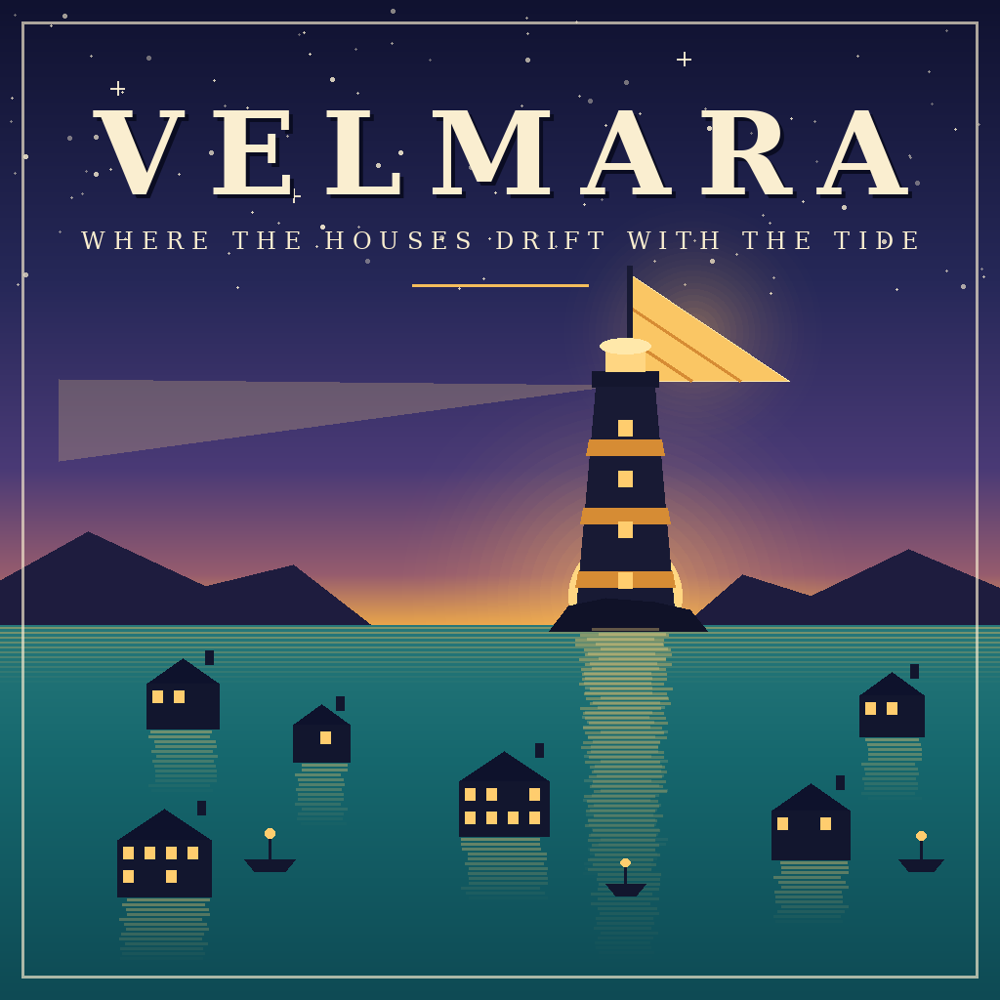

# poster-20261121-cand-a

[](https://make.fun/bounty/the-poster-for-a-place-that-i-2-20261121-0539?utm_source=github&utm_medium=readme&utm_campaign=the-poster-for-a-place-that-i-2-20261121-0539)
[](https://make.fun/bounty/the-poster-for-a-place-that-i-2-20261121-0539/leaderboard?utm_source=github&utm_medium=readme&utm_campaign=the-poster-for-a-place-that-i-2-20261121-0539)
[](https://make.fun/bounty/the-poster-for-a-place-that-i-2-20261121-0539?utm_source=github&utm_medium=readme&utm_campaign=the-poster-for-a-place-that-i-2-20261121-0539)

"VELMARA — The City That Sails at Dusk" — a travel poster for a place that
isn't there: an invented lagoon city whose houses drift on the water at dusk,
anchored by one landmark, a tall sailing lighthouse whose light is a warm
gold sail. Giant cream serif name across the top third, the lighthouse
slightly right of centre, drifting house-lights and their reflections leading
the eye down to a calm horizon. Deep dusk indigo, teal water, warm gold light
— a stay there feels slow, golden, unhurried.



## Run it

```
MAKEFUN_OUTPUT_DIR=out node main.ts
```

`main.ts` runs `build_entry.py` (Python 3 + Pillow, no network, deterministic),
validates the generated `entry.png` (PNG, exactly 1024×1024, at most 1 MiB)
and copies it to the output directory (default `/output`).

Made with [make.fun](https://make.fun/bounty/the-poster-for-a-place-that-i-2-20261121-0539?ref=pnttjnyx).
